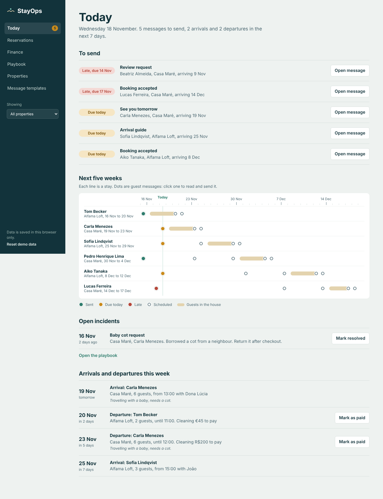
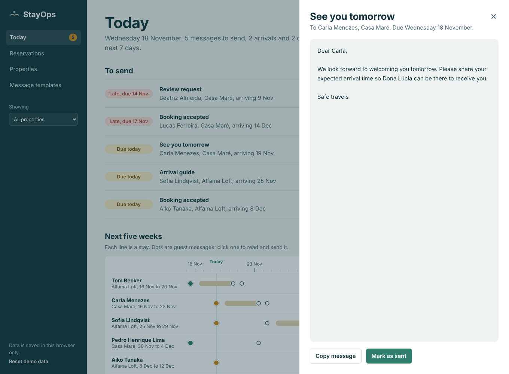
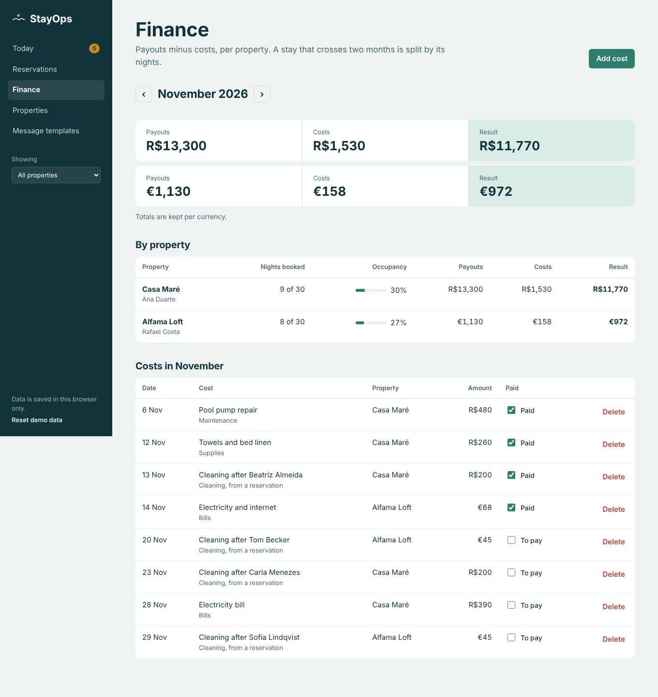
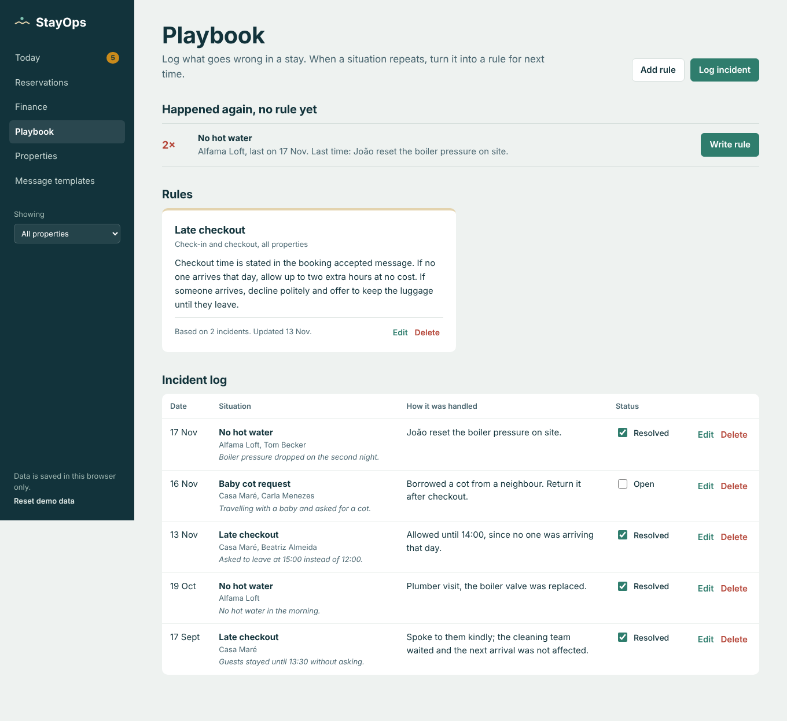
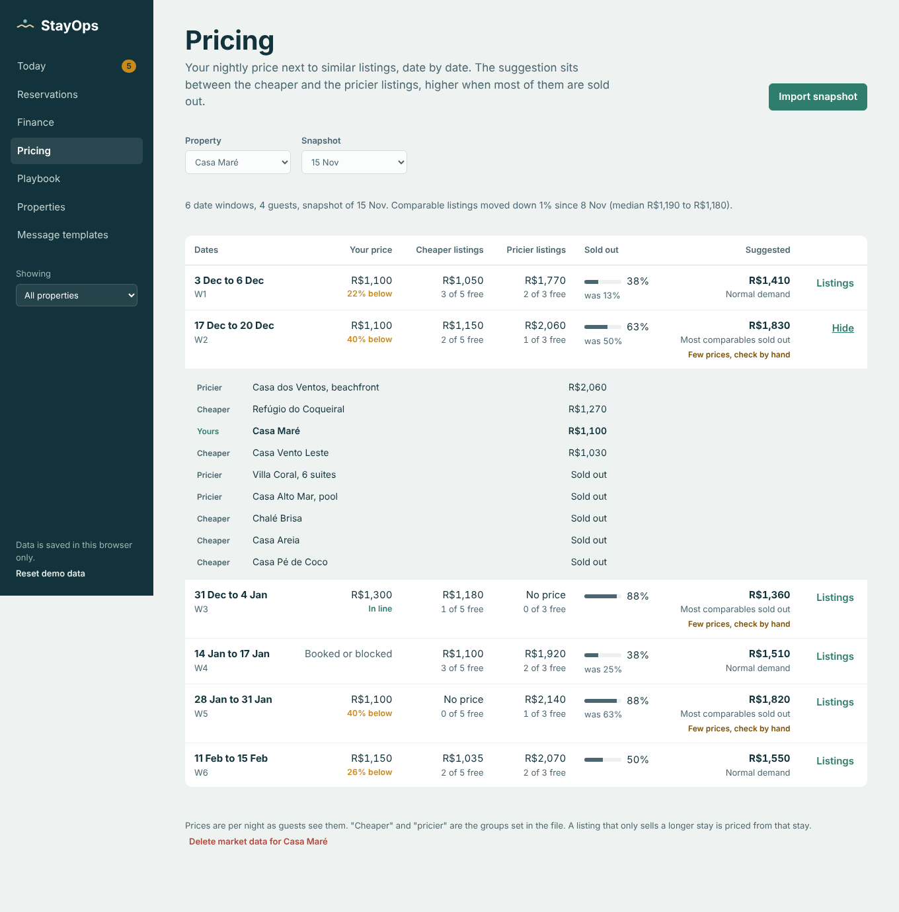

# StayOps

Guest communication and reservations for short-term rental hosts who manage more than one property.

**Live demo:** https://marinajlima.github.io/airbnb_host/



## Why I built it

I co-manage a beach house on Airbnb in northeast Brazil. Every booking triggers the same routine: a welcome message, an arrival guide a week before, a note the day before, a checkout reminder, a review request, and paying the cleaning team on checkout day. I ran all of it from a spreadsheet, a doc of message templates and my own memory.

That works for one house. It breaks the moment a second owner asks for help. StayOps turns that routine into a product: enter a booking once and the app tells you what to send, when, and fills in the details.

## What it does today

- **Today view.** Lists the messages due now or late, shows every stay on a shared five-week timeline, and lists arrivals and departures for the week with the cleaning payment due.
- **Message timeline.** Each template has a rule such as "7 days before check-in". The app schedules it for every reservation and fills in guest name, dates, times and the person who welcomes guests. Copy the text, send it on Airbnb, mark it as sent.
- **Reservations.** Add, edit and delete stays. Flags guests above the number included in the price, so extra guest fees are never missed.
- **Finance.** Month by month: payouts, costs, result and occupancy for each property and owner. Each reservation creates its cleaning cost on checkout day, and the Today view lets you mark it as paid. Other costs (repairs, supplies, bills) are added by hand.
- **Pricing.** Import a market snapshot (a CSV of similar listings, date by date) and compare your nightly price with the cheaper and the pricier group. Each date window gets a suggested price, the share of comparables already sold out, and how the market moved since the previous snapshot. Windows with too few prices are flagged for a manual check.
- **Playbook.** Log what went wrong in a stay and how it was handled. When the same situation happens twice at a property with no rule yet, the app asks you to write one, showing how it was handled each time. Logging an incident that already has a rule shows the rule as you type.
- **Properties and owners.** Each property has its own house rules, currency, cleaning cost and on-site host, grouped by owner.









## Product decisions

| Decision | Reason |
| --- | --- |
| Messages are copied, not sent automatically | Airbnb has no open messaging API for small hosts. Copy and mark as sent keeps the host in control and needs no integration. |
| Data stays in the browser for now | No sign-up, no server, no personal data stored anywhere. Good enough to validate the workflow before building accounts. |
| Short-notice bookings pull earlier messages to the booking day | A guest who books 3 days ahead still needs the arrival guide, so the app never schedules a message in the past. |
| Demo data is fictional and relative to today | The live demo always has something due, without exposing real guests. |
| Revenue is split across months by nights | A stay from 29 December to 3 January belongs to both months. Counting it all on check-in would inflate one month and hide the other. |
| Cleaning is created by the reservation, not typed in | It happens after every stay, so the app adds it on checkout day and keeps it in step if the dates change. Forgetting to pay the team is the error this prevents. |
| Totals are kept per currency | Owners in Brazil and Portugal are paid in BRL and EUR. Adding them up would need an exchange rate nobody agreed on. |
| A rule is suggested on the second occurrence, not the first | One late checkout is an event. Two is a pattern worth a decision. Asking earlier would turn the playbook into a diary. |
| Situations are grouped by name, with suggestions while typing | Free text keeps logging fast. Suggesting names already used keeps "Late checkout" from becoming five different spellings. |
| The suggestion is a rule you can read, not a model | Halfway between the cheaper and the pricier group, a quarter of the way when most comparables are free, three quarters when most are sold out. A host can explain it to an owner in one sentence and argue with it. |
| Sold-out share is the demand signal | Small hosts cannot see other listings' bookings, but they can see which ones have no dates left. That is the closest public signal to demand. |
| Thin data is flagged instead of hidden | Around holidays most listings sell out and a window may have a single price. The app still suggests a number but says to check it by hand. |
| Market data is imported, not scraped by the app | Collection runs separately on the host's own computer. The app only reads the file, so it stays a static site and nothing about other listings is stored online. |
| Saved data upgrades itself | Browsers that used Layer 1 get their cleaning costs created on first load, so nobody loses their reservations. |

## Roadmap

Built in layers, each one usable on its own.

1. **Guest messages and reservations** (done)
2. **Finance:** payouts, cleaning and other costs, monthly result per property and owner (done)
3. **Incident log and playbook:** record what went wrong in a stay and turn repeated cases into house rules (done)
4. **Pricing:** compare nightly rates with similar listings from periodic market snapshots (done)
5. **Accounts:** sign-in and a shared database so each owner sees their own properties

## Tech

React 19, TypeScript and Vite. No UI library: the layout and the timeline are hand-written CSS. Deployed to GitHub Pages by a GitHub Actions workflow on every push to `main`.

```
src/
  types.ts        data model: owners, properties, reservations, templates
  schedule.ts     when each message is due, and template filling
  seed.ts         fictional demo data
  finance.ts      monthly result, revenue split by nights, cleaning costs
  playbook.ts     groups incidents by situation, finds repeats without a rule
  pricing.ts      CSV import, per-window comparison and suggested price
  store.ts        saves to localStorage, upgrades older saved data
  components/     one file per screen
```

## Market snapshot format

One row per listing, per date window, per snapshot. Column names can be in English or Portuguese.

| Column | Also accepted | Example |
| --- | --- | --- |
| `snapshot_date` | `data_coleta` | 2026-11-15 |
| `listing_id` (optional) | `id` | 1234567 |
| `listing_name` | `apelido` | Casa Areia |
| `tier` | `grupo` | `mine`, `higher` or `lower` (also `casa_sal`, `referencia`, `comparavel`) |
| `window` | `janela` | W1 |
| `check_in`, `check_out` | | 2026-12-04 |
| `guests` | `adultos` | 4 |
| `status` | `status_datas` | `available`, `unavailable` or `min_nights` |
| `nightly` | `por_noite` | 1050 |
| `discount` (optional) | `desconto_visivel` | false |

Importing a snapshot date that already exists replaces it, so a corrected file can be imported again.

## Run it locally

You need [Node.js](https://nodejs.org) 20 or newer.

```bash
npm install
npm run dev
```

Then open the address shown in the terminal.

## Author

Marina Lima, product manager. Built to run a real rental operation and to show how I take a messy process from discovery to a working product.
